<picture>
  <source media="(prefers-color-scheme: dark)" srcset="assets/header-dark.svg">
  
</picture>

**EN** · [ES ↓](#español)

Final-year Computer Science student at the University of Havana (MatCom). I like building whole systems end to end: from the parser to the IDE, from the retrieval model to the answer, from raw sockets to the UI.

**Open to internships and junior software engineering roles.**

### What I do best

**AI & information retrieval** 
RAG on a Bayesian inference-network model with multimodal (CLIP) search. LangGraph agents that write full-stack apps, test them in Docker sandboxes and fix their own mistakes. 
[tech-rag](https://github.com/jccarmenate/tech-rag-information-retrieval-system) · [multiagent-code-generator](https://github.com/jccarmenate/multiagent-code-generator) · [ReviewLens](https://github.com/jccarmenate/ReviewLens)

**Compilers & language tooling** 
A Rust / LLVM 17 compiler for the HULK language, with its own LSP server and VS Code extension. 
[hulk-ide](https://github.com/jccarmenate/hulk-ide)

**Systems & networking** 
A multi-threaded C99 security monitor for Linux. Link-layer P2P chat over raw sockets with X25519 + ChaCha20-Poly1305. A captive portal. 
[MatCom-Guard](https://github.com/jccarmenate/MatCom-Guard) · [Link-Chat](https://github.com/jccarmenate/Link-Chat) · [Captive-Portal](https://github.com/jccarmenate/Captive-Portal)

**Real-time & full-stack** 
A multiplayer whiteboard synced with Yjs CRDTs on Cloudflare Durable Objects. A role-based project manager with JWT refresh-token rotation. 
[live-cooperating-dashboard](https://github.com/jccarmenate/live-cooperating-dashboard) · [GuildWork](https://github.com/jccarmenate/GuildWork)

**Algorithms & modeling** 
An ICPC team reference tested against brute force. An MCTS + RAVE Hex AI. SEIR discrete-event simulation and Monte Carlo portfolio analysis. 
[ICPC-Team-Reference](https://github.com/jccarmenate/ICPC-Team-Reference) · [HexArena](https://github.com/jccarmenate/HexArena) · [Population-Simulation](https://github.com/jccarmenate/Population-Simulation) · [quantedge](https://github.com/jccarmenate/quantedge)

### Tools

`Python` `TypeScript` `Rust` `C` `C++` 
LangGraph · FastAPI · LLVM · Next.js · Astro · Yjs · Docker · PostgreSQL · SQLite · Flutter

### Contact

[Portfolio](https://portfolio-web-eight-rose.vercel.app/) · [juancarlosmatcom@gmail.com](mailto:juancarlosmatcom@gmail.com)

 

### Español

Estudiante de último año de Ciencias de la Computación en la Universidad de La Habana (MatCom). Me gusta construir sistemas completos de punta a punta: del parser al IDE, del modelo de recuperación a la respuesta, de los sockets raw a la interfaz.

**Busco prácticas y puestos de ingeniero de software junior.**

- **IA y recuperación de información:** RAG, búsqueda multimodal y agentes que generan, prueban y corrigen código.
- **Compiladores:** compilador de HULK en Rust / LLVM con servidor LSP y extensión de VS Code.
- **Sistemas y redes:** monitor de seguridad en C, chat P2P sobre sockets raw con cifrado y un portal cautivo.
- **Tiempo real y full-stack:** pizarra colaborativa con CRDTs y un gestor de proyectos con permisos por rol.
- **Algoritmos y modelado:** referencia ICPC, IA de Hex con MCTS y simulación epidemiológica.
